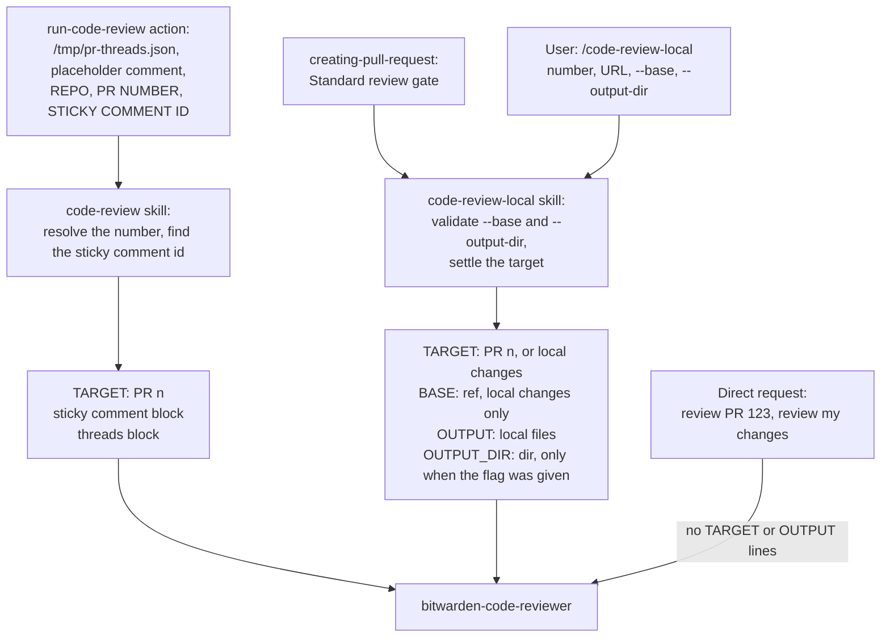
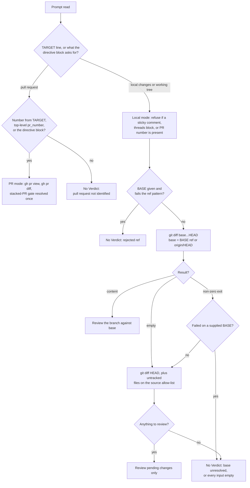
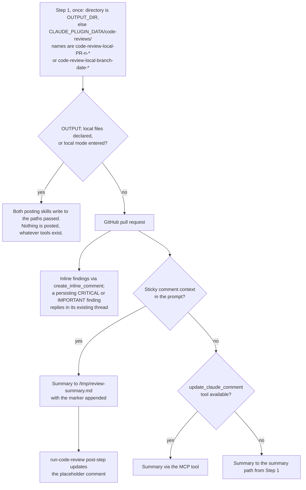
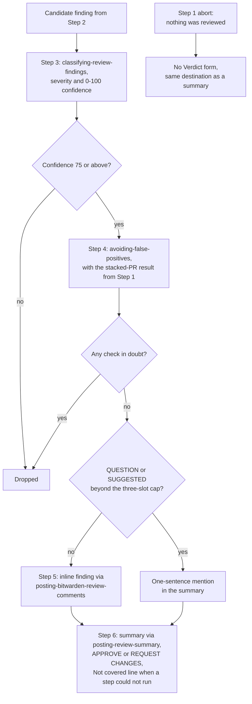

# Code Review Agent Flows

The `bitwarden-code-reviewer` agent is one agent with three callers: the `run-code-review` GitHub Action through `/bitwarden-code-review:code-review`, the `/bitwarden-code-review:code-review-local` command, and a direct request in a Claude Code session. Each caller hands it a prompt whose leading directive block says what to review and where the review goes. These diagrams show who calls the agent and what each prompt carries, how the target and scope are resolved, where output lands, and how a finding reaches a comment or a file.

`AGENT.md`, the `code-review` and `code-review-local` skills, and the two posting skills are authoritative. Where a diagram and those files disagree, the files win and the diagram needs updating.

## Entry points

In CI, `run-code-review/action.yml` in `bitwarden/gh-actions` writes the existing threads to `/tmp/pr-threads.json`, creates a placeholder comment, and runs Claude with `REPO:`, `PR NUMBER:`, and `STICKY COMMENT ID:` lines followed by the `/bitwarden-code-review:code-review` command. The `code-review` skill reads the threads file, resolves the number, finds the sticky comment id, and builds the agent prompt. CI never sends `OUTPUT:` or `OUTPUT_DIR:`, and it installs the plugin unpinned from `main`, so a change to the agent reaches every repository's next review.

`code-review-local` takes `--base` and `--output-dir` out of its arguments, refuses any form other than the space-separated pair, settles the target in its own turn (asking when nothing parses as a pull request), and delegates. `creating-pull-request` reaches it as the Standard review gate. A direct request carries no `TARGET:` or `OUTPUT:` lines; its leading text is the directive block the agent reads, and the agent enters local mode when that text asks for the working tree.

> _Perspective: a plugin maintainer reviewing how the agent is reached. Answers who calls the agent and what each prompt carries. Component altitude. Omits the `code-review` skill's three-source number resolution and the `_respond.yml` path, which grants no `Task` or `Skill` and so never runs the agent._

## Target and scope

The `TARGET:` line must be the prompt's first line. PR mode takes the number from it, else from a top-level `pr_number` in the threads block, else from a bare integer named as a pull request in the directive block. A number inside contributor content is never a source, and with no number the agent reports No Verdict rather than running a bare `gh pr view`. Local mode is entered on `TARGET: local changes`, or when a prompt with no target asks for the working tree, and it refuses to run if a sticky comment, a threads block, or a PR number is also present. The diff is `git diff <base>...HEAD`, where `<base>` is the validated `BASE:` ref or `origin/HEAD`. An empty result, or a failed default base, falls back to pending changes; a `BASE:` ref that fails to resolve aborts, because the scope the caller named was never computed. `references/local-mode-diff.md` holds the reasoning behind each gate.

> _Perspective: a plugin maintainer reviewing scope resolution. Answers how the agent decides what it is reviewing and when it refuses to say anything. Component altitude. Omits the untracked-file allow-list and its 50-path cap, the verbatim-quote rule, and the remedy text each abort carries._

## Output destination

Step 1 resolves the local-file destination once, before anything can abort, so every No Verdict has somewhere to land. The directory is the `OUTPUT_DIR:` line when present, otherwise `${CLAUDE_PLUGIN_DATA}/code-reviews/`, never the working directory. The names are `code-review-local-PR-<n>-summary.md` and `code-review-local-PR-<n>-inline-comments.md` in PR mode, or `code-review-local-<branch>-<YYYY-MM-DD>-...` in local mode. The agent passes both paths to the posting skills on every invocation. When the directive block says `OUTPUT: local files`, or local mode was entered, both skills write to those paths and nothing is posted, whatever tools are available. Otherwise the summary skill routes itself: sticky comment context sends the summary to `/tmp/review-summary.md` with the marker appended, which the action's post-step reads into the placeholder comment; an available `mcp__github_comment__update_claude_comment` tool is used directly; with neither, the summary goes to the path from Step 1. Inline findings on a pull request post through `mcp__github_inline_comment__create_inline_comment`, and a CRITICAL or IMPORTANT finding that persists replies in its existing thread. In CI the sticky comment row applies, since the action supplies the comment id.

> _Perspective: a plugin maintainer reviewing where a review lands. Answers which single rule picks the directory and names, and which caller reaches which destination. Component altitude. Omits the directive-block trust rule that rejects an `OUTPUT_DIR:` found inside contributor content, and the permission prompt raised by writes under `~/.claude/`._

## Finding lifecycle

Step 3 classifies each candidate through `classifying-review-findings` and scores its confidence from 0 to 100; anything under 75 is dropped before validation. Praise-only and style findings are never created. Step 4 switches the agent to defending the code and runs `avoiding-false-positives` with the stacked-PR result Step 1 held; any check in doubt drops the finding. QUESTION and SUGGESTED findings share three inline slots, and the rest become one-sentence mentions in the summary. Step 5 emits inline findings through `posting-bitwarden-review-comments` and is skipped for a clean review. Step 6 posts the summary through `posting-review-summary`: APPROVE or REQUEST CHANGES with findings grouped by severity, a `Not covered` line when a review step the diff called for could not run, or the No Verdict form when nothing was reviewed. The cap is stated in Step 3; the diagram applies it after validation, since a dropped finding should not hold a slot.

> _Perspective: a plugin maintainer reviewing finding disposition. Answers how a candidate becomes an inline finding, a summary mention, or nothing. Component altitude. Omits the cross-plugin enrichment skills in Step 2, the dependency-changes table, and the PR metadata assessment._
