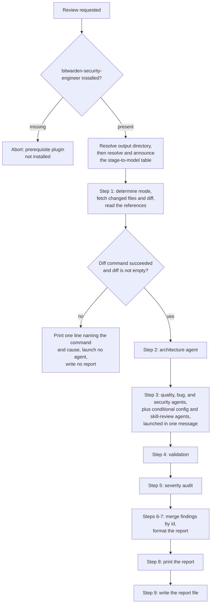
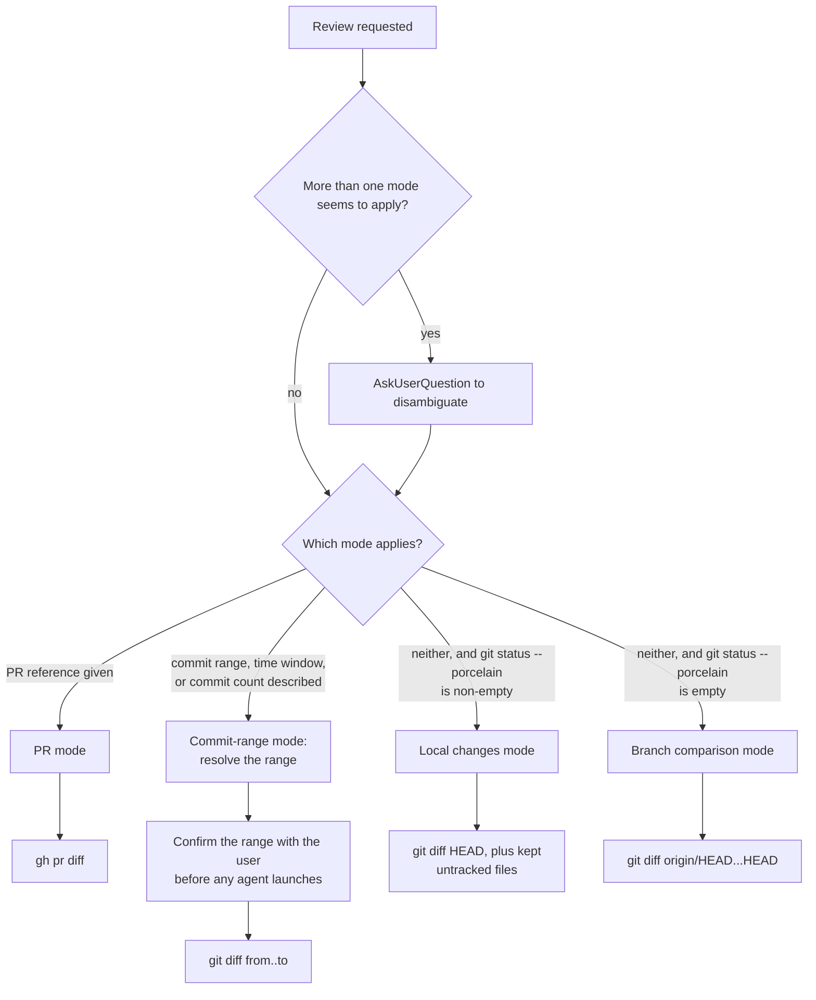
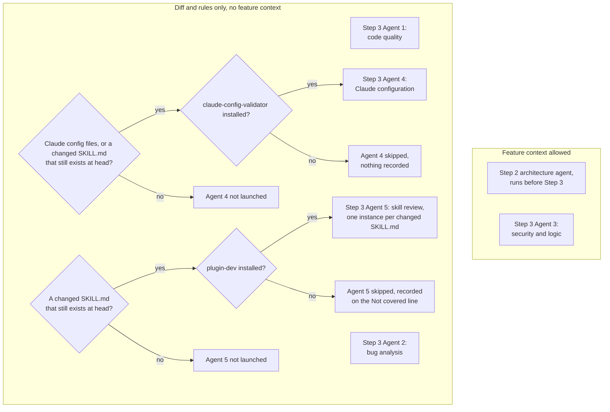
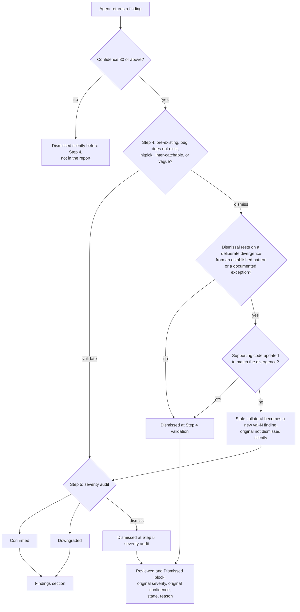

# Multi-Agent Code Review Flows

The `performing-multi-agent-code-review` skill runs a fixed pipeline, and several of its decisions live in separate files: the mode rules in `references/modes.md` and the report rules in `references/report-template.md`. These diagrams show the pipeline's order, how the diff source is chosen, which agents run and see feature context, and how a finding reaches the report.

The skill's `SKILL.md` and `references/` are authoritative. Where a diagram and the skill disagree, the skill wins and the diagram needs updating.

## Pipeline

Prerequisites and model resolution run before Step 1. A missing prerequisite plugin aborts the review, and an ignored security-model pin is noted in the model announcement. The skill requires only that these run before Step 1, so their order in the diagram follows the order of the skill's sections. A failed diff command or an empty diff stops the review before Step 2: no agent launches and no report is written. Steps 6-9 run in the main agent because the merge needs the full finding state and reference content in context. The skill runs the steps in order and forbids skipping, reordering, or combining them. The arrows show that order, not data dependencies.

> _Perspective: a skill maintainer reviewing the multi-agent review skill. Answers what the review does from request to report. Component altitude. Omits stage failures and what each agent does._

## Mode selection

The mode decides which commands produce the diff, so it is settled before Step 2. The four modes are mutually exclusive, and when more than one seems to apply the skill asks the user instead of guessing. Commit-range mode also confirms the resolved range with the user before any agent launches, because a wrong range wastes substantial tokens and time.

> _Perspective: a skill maintainer reviewing diff-source selection. Answers how the skill chooses where the diff comes from. Component altitude. Omits per-mode setup such as PR full-file reads, range resolution, and untracked-file filtering._

## Agents and context

Feature context (issue descriptions, tickets, PR history, product framing) sharpens adversarial thinking but biases a baseline read of the diff. The architecture and security agents get it, including the PR title and description in PR mode. The quality and bug agents get only the diff and the Review Rules. Agent 4 is also diff-only, and each Agent 5 instance gets only the one `SKILL.md` it reviews and that skill directory's hunks. When Agent 4 would run but `claude-config-validator` is missing, it is skipped with no record. When Agent 5 would run but `plugin-dev` is missing, the omission is recorded on the `Not covered` line, because `SKILL.md` sits outside the config bucket, so no other agent applies the skill lens and an unrecorded omission reads as a pass.

> _Perspective: a skill maintainer reviewing agent launch and context rules. Answers which agents run and which of them see feature context. Component altitude. Omits what each agent is told and how Agent 5's output becomes findings._

## Finding lifecycle

Only findings at confidence 80 or above leave the review agents. Anything lower is dismissed silently before Step 4 and never appears in the report. Step 4 dismisses a finding that is pre-existing, describes a bug that does not exist, is a nitpick, is linter-catchable, or is vague. Step 5 confirms a finding's severity, downgrades it, or dismisses it when it meets no severity's bar. A dismissal at either step is kept in the report with its original severity, confidence, stage, and reason, so a human can judge a wrong dismissal. The skill does not say outright that Step 5 audits `val-N` findings. The diagram assumes it, because Step 6 inserts them into the master map before merging Step 5's returns. The skill also does not say what happens to the original finding beyond "do not dismiss the original finding silently."

Stage failures are left out of the diagram. When Step 4 fails, its findings keep the review agent's severity and render `not validated`. When Step 5 fails, findings validated in Step 4 render `not audited`. A failed Step 2 or Step 3 agent is named on the `Not covered` line. After any failure, the Summary's assessment starts with `Review incomplete:`. The skill does not say whether Step 5 still runs after a Step 4 failure.

> _Perspective: a skill maintainer reviewing finding disposition. Answers how a finding reaches the report or the Dismissed block. Component altitude. Omits stage failures and the CWE-1427 exception to the pre-existing rule._
