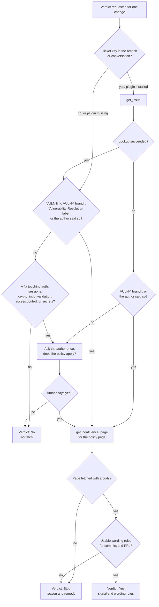
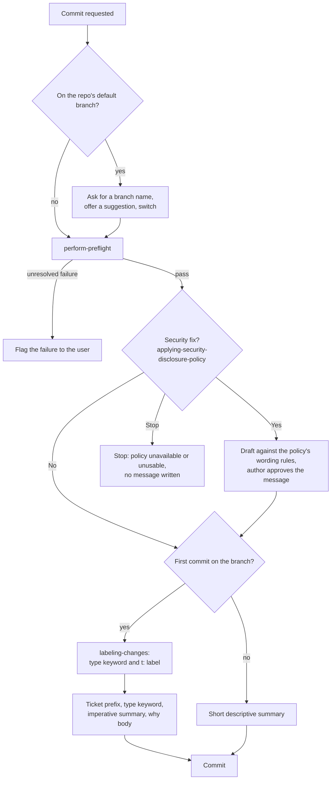
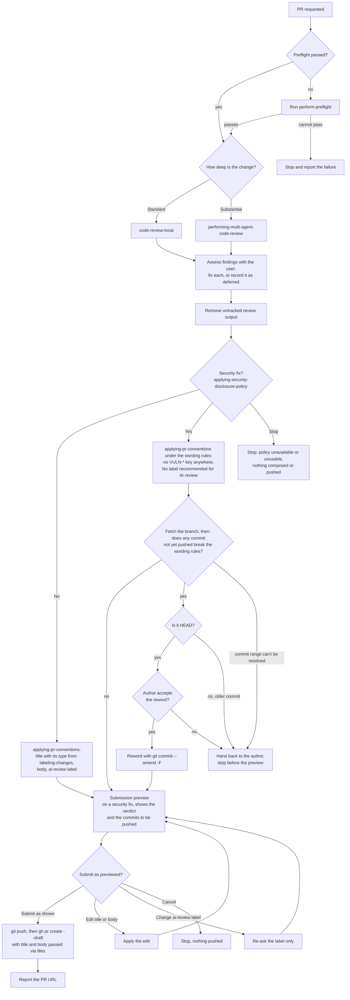
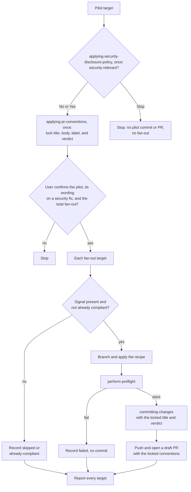

# Commit and Pull Request Flows

The commit and pull request skills compose one another, so a change to one skill's contract can ripple into every skill that calls it. These diagrams show those seams: which skill owns each decision, and where control passes between skills.

The `SKILL.md` files are authoritative. Where a diagram and a skill disagree, the skill wins and the diagram needs updating.

## Deciding whether the disclosure policy applies

`committing-changes`, `applying-pr-conventions`, and `force-multiplier` all branch on the verdict `applying-security-disclosure-policy` returns. Most changes leave at the first `No` without a Confluence fetch. A security-relevant change gets rules only from the fetched policy page, and anything short of usable rules is a `Stop`.

> _**Perspective:** For maintainers of the delivery skills, showing how `applying-security-disclosure-policy` reaches one of its three verdicts for a single change. Inside the one skill. Omits how callers act on each verdict, which the flows below show._

## Committing a change

The branch check runs before anything is staged, so work never lands on the default branch by accident. The disclosure check runs before any message is written, because a commit message can't be reworded once it's pushed. It is skipped when the caller passes a verdict it already settled, as `force-multiplier` does after its pilot. Only the first commit on a branch needs the full message format; followups can be a short summary.

## Opening a pull request

Preflight settles before the review because fixing a preflight failure can change the diff the review needs to see. The submission preview is the single point where every decision is visible together, and nothing is pushed until the user confirms it. Editing the label from the preview re-asks only the label, since re-entering `applying-pr-conventions` would recompose the title and body and discard an edit already made.

The security-fix decision comes before any title or body exists: `applying-pr-conventions` calls `applying-security-disclosure-policy` first, and its verdict decides how the strings are composed. On a security fix, the push publishes the branch's commits as well as the PR title, so the commits not yet on the remote are checked against the same wording rules before the preview. Commits already pushed are out of scope: this is a check before the push, and they're already public.

## Fanning a change across many targets

`force-multiplier` reuses the same skills across a fleet but cannot answer the conventions or disclosure questions once per target, so it resolves them once at the pilot and locks the result. On a security fix the author approves the pilot's wording once, and a `Stop` ends the campaign before the pilot commits anything. Every fan-out target then runs preflight and commits non-interactively against that locked title, body, label, and security verdict.

